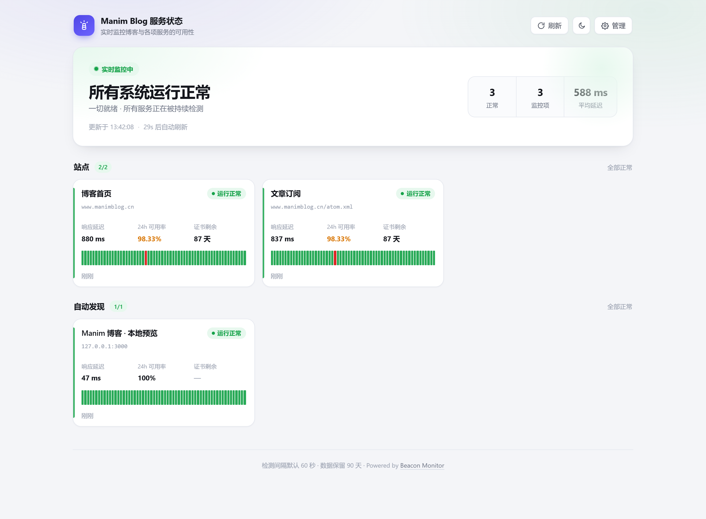
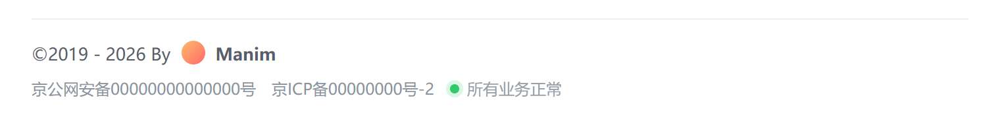
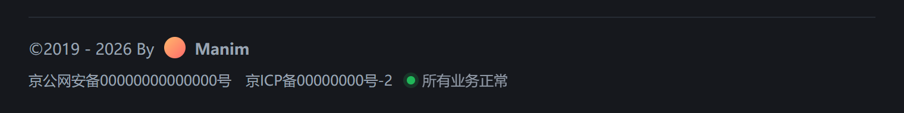
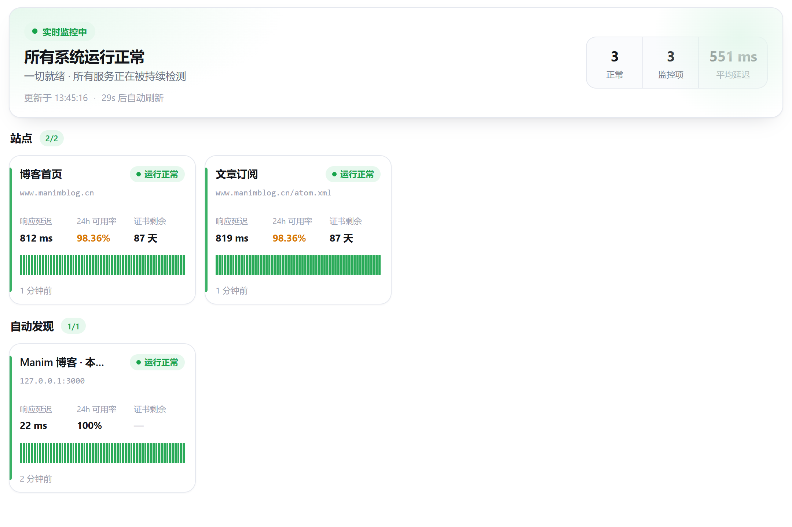
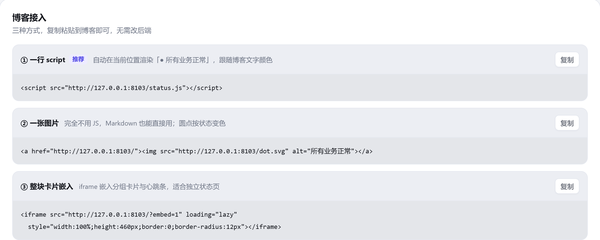
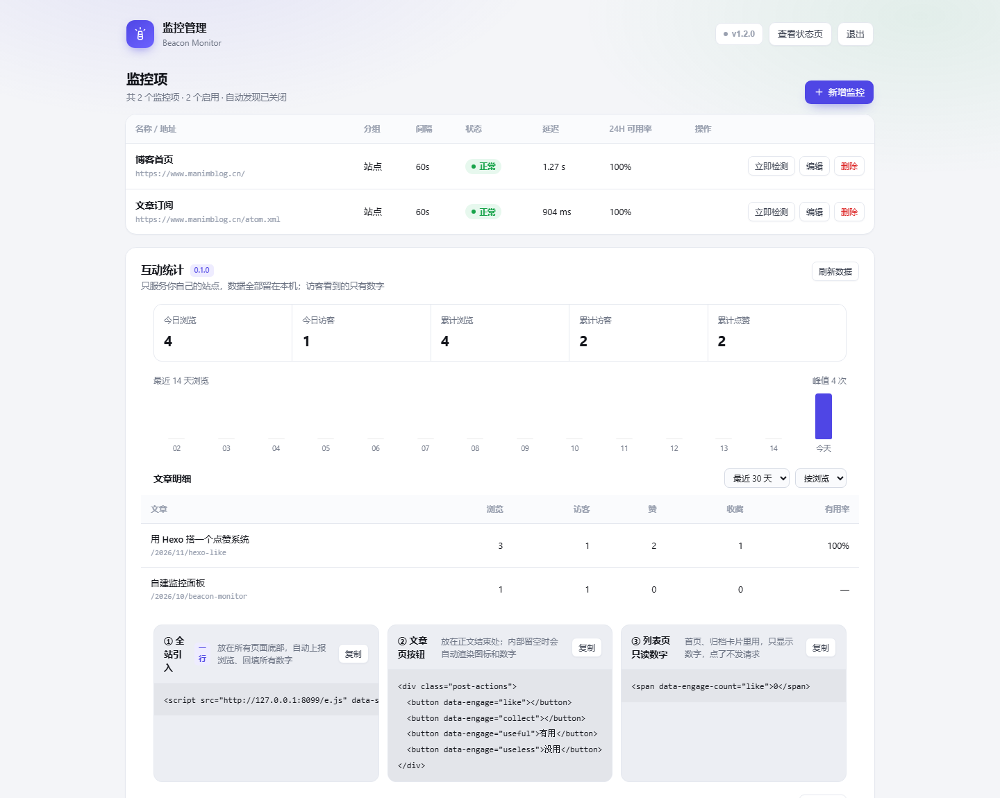
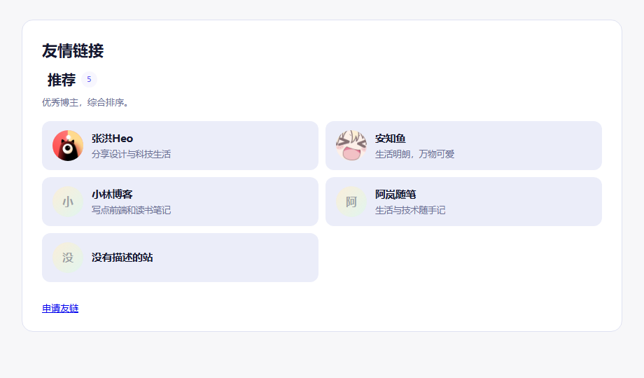
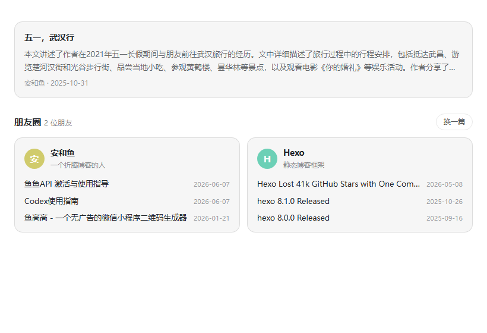
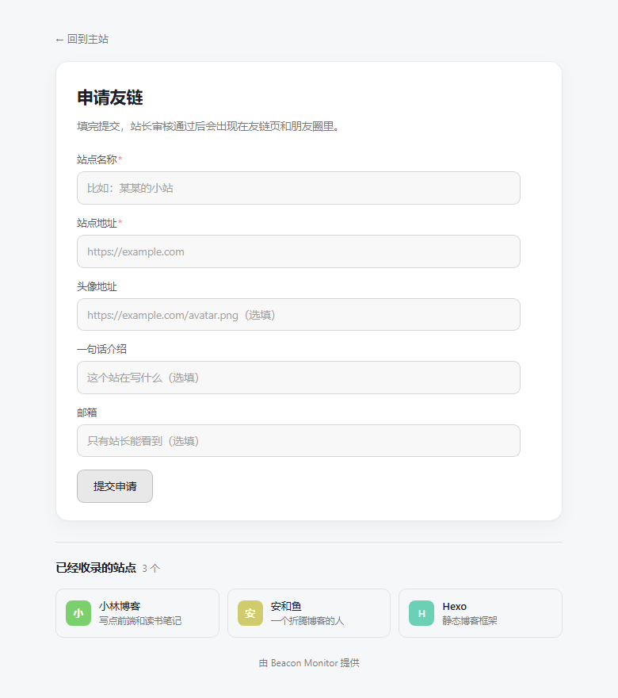
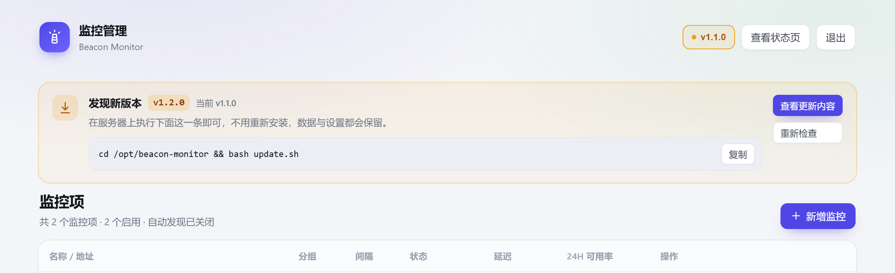

# Beacon Monitor

**一条命令装好的站点可用性监控 + 状态页。自动发现服务器上已经在跑的服务，不用手工加监控项。**

[](LICENSE)
[](docker-compose.yml)
[](package.json)

```bash
curl -fsSL https://raw.githubusercontent.com/hexoblog-web-site/beacon-monitor/main/install.sh | bash
```

装完打开 `http://服务器IP:8080/` 就是状态页，`/admin` 是后台（密码在安装输出和 `.env` 里）。

挂到博客上也只要一行：

```html
<script src="https://你的状态页域名/status.js"></script>
```



---

## 目录

- [为什么用它](#为什么用它)
- [三种安装方式](#三种安装方式)
- [自动发现：为什么不用手配](#自动发现为什么不用手配)
- [部署到云服务器](#部署到云服务器)
- [绑定域名与 HTTPS](#绑定域名与-https)
- [接入到你的博客](#接入到你的博客)
- [互动统计：点赞、收藏、浏览量](#互动统计点赞收藏浏览量)
- [友链与友圈](#友链与友圈)
- [配置项](#配置项)
- [通知](#通知)
- [从 Glue 迁移](#从-glue-迁移)
- [自动更新](#自动更新)
- [运维](#运维)
- [常见问题](#常见问题)
- [本地开发](#本地开发)
- [安全说明](#安全说明)
- [License](#license)

## 为什么用它

|  | Beacon Monitor | Uptime Kuma | 哪吒监控 |
| --- | --- | --- | --- |
| 安装 | 一行命令，自动装 Docker、挑端口、生成密码 | 手动 compose + 逐个加监控 | 服务端 + 被控端 agent |
| 新增监控项 | **自动扫本机服务并收录** | 手工填写 | 手工填写 |
| 资源占用 | 单容器，约 60–80 MB | 稍重 | 需 agent |
| 界面形态 | 分组状态页（灯塔 / HeoStatus 风格） | 列表 + 状态页 | 面板 + 状态页 |
| 适合 | 个人博客、小站，一台机器几个服务 | 通用监控 | 服务器运维 |

适合：**一台服务器 + 几个自建服务（博客、图床、API、面板）**，想要一个像 `lighthouse.zhheo.com` 那样的状态页，又不想挨个配监控项。

## 三种安装方式

### 方式一：一行命令（推荐）

```bash
curl -fsSL https://raw.githubusercontent.com/hexoblog-web-site/beacon-monitor/main/install.sh | bash
```

脚本自动完成：

1. 检测 / 安装 Docker（已装则跳过）
2. 下载代码到 `/opt/beacon-monitor`（无权限时退到 `~/beacon-monitor`）
3. 生成 `.env`，**随机 12 位管理密码**
4. 挑一个没被占用的端口（8080 → 8081 → 8090 → 18080）
5. `docker compose up -d --build` 构建并启动
6. 等健康检查通过，打印访问地址和密码

自定义密码和端口：

```bash
ADMIN_PASSWORD=my-secret HOST_PORT=8080 \
  bash <(curl -fsSL https://raw.githubusercontent.com/hexoblog-web-site/beacon-monitor/main/install.sh)
```

> 不想让脚本自动装 Docker：加 `SKIP_DOCKER_INSTALL=1`。

### 方式二：docker run（镜像由 CI 构建）

```bash
docker run -d --name beacon-monitor --restart unless-stopped \
  -p 8080:8080 \
  -v /opt/beacon-monitor/data:/data \
  -v /var/run/docker.sock:/var/run/docker.sock:ro \
  --add-host host.docker.internal:host-gateway \
  --label com.centurylinklabs.watchtower.enable=true \
  -e ADMIN_PASSWORD=你的密码 \
  -e AUTO_UPDATE=1 \
  -e TZ=Asia/Shanghai \
  ghcr.io/hexoblog-web-site/beacon-monitor:latest
```

> 镜像由 GitHub Actions 构建并推到 GHCR。首次构建完成后，到仓库 **Packages → beacon-monitor → Package settings** 把可见性改成 **Public**，否则 `docker pull` 需要先 `docker login ghcr.io`。
>
> 想让这个容器也能自动升级，再起一个 watchtower（只认上面那个 label）：
>
> ```bash
> docker run -d --name beacon-watchtower --restart unless-stopped \
>   -v /var/run/docker.sock:/var/run/docker.sock \
>   -e WATCHTOWER_LABEL_ENABLE=true -e WATCHTOWER_CLEANUP=true \
>   -e WATCHTOWER_POLL_INTERVAL=3600 \
>   containrrr/watchtower:latest
> ```

### 方式三：docker compose（想改代码）

```bash
git clone https://github.com/hexoblog-web-site/beacon-monitor.git
cd beacon-monitor
cp .env.example .env        # 改 ADMIN_PASSWORD
docker compose up -d --build
docker compose logs -f      # Ctrl+C 退出日志
```

## 自动发现：为什么不用手配

启动 6 秒后开始第一轮扫描，之后每 10 分钟一次。发现新的 Web 服务就**自动建监控项**，分组「自动发现」。

```
        ┌────────────────────────────────────┐
        │ ① 读 Docker（只读 socket）           │ 容器 → 映射到宿主机的端口
每 10   │ ② 扫宿主网关常见 Web 端口            │ 非 Docker：Nginx / Hexo / Node / Grafana…
分钟 ──▶└─────────────────┬──────────────────┘
                          ▼
              ┌────────────────────────┐
              │ ③ HTTP 验证 2xx / 3xx   │ 用页面 <title> 当名字
              └───────────┬────────────┘
                          ▼
            自动建监控项（分组：自动发现，间隔 120s）
```

| 探测路径 | 能发现什么 | 依赖 |
| --- | --- | --- |
| Docker API | 所有运行中容器里**映射到宿主机**的端口 | `/var/run/docker.sock` 只读挂载 |
| 端口探测 | 直接装在系统里的 Nginx、Hexo、Node、Grafana、Uptime Kuma… | 能访问宿主网关 `host.docker.internal` |

内置探测端口：`80 443 3000 4000 4321 5000 5173 7860 8000 8008 8080 8081 8088 8090 8443 8888 9000 9090 2368 5001 8501 10086`
自定义：`.env` 里 `DISCOVER_PORTS=8080,9000,12345`。

几条规则，避免它「自作聪明」：

- **只新增**，从不修改、停用或删除你手工建的监控项
- 同一 URL 只收录一次；已存在的地址直接跳过
- 后台删掉一个自动项 → 该地址进忽略名单，**不会再被扫出来**
- 只收录 HTTP 能正常响应（2xx/3xx）的地址，不会把数据库、SSH 端口塞进列表
- 完全关闭：`AUTO_DISCOVER=0`；或删掉 compose 里的 `docker.sock` 挂载（退化为纯端口探测）

## 部署到云服务器

以腾讯云轻量应用服务器（Ubuntu 22.04 / Debian 12）为例，root 执行：

```bash
# 1. 一行安装（缺 Docker 会自动装）
curl -fsSL https://raw.githubusercontent.com/hexoblog-web-site/beacon-monitor/main/install.sh | bash

# 2. 看日志确认在跑
cd /opt/beacon-monitor && docker compose logs -f --tail=50
```

**3. 放行端口**：控制台 → 轻量应用服务器 → 实例 → 防火墙 → 添加规则

| 应用类型 | 协议 | 端口 | 来源 |
| --- | --- | --- | --- |
| 自定义 | TCP | 8080 | 0.0.0.0/0 |

访问 `http://服务器公网IP:8080/` 即可。国内机器拉基础镜像慢时，可在 `/etc/docker/daemon.json` 配镜像加速；构建时 npm 默认走 npmmirror，通常 1–3 分钟。

其他平台（VPS / NAS / 群晖 / 树莓派）同理：能跑 Docker 就行，`linux/amd64` 与 `linux/arm64` 都有镜像。

## 绑定域名与 HTTPS

```nginx
server {
    listen 80;
    server_name status.example.com;

    location / {
        proxy_pass http://127.0.0.1:8080;
        proxy_set_header Host $host;
        proxy_set_header X-Real-IP $remote_addr;
        proxy_set_header X-Forwarded-For $proxy_add_x_forwarded_for;
        proxy_set_header X-Forwarded-Proto $scheme;
    }
}
```

```bash
nginx -t && systemctl reload nginx
apt install -y certbot python3-certbot-nginx && certbot --nginx -d status.example.com
```

签好证书后建议只监听本机，避免绕过 HTTPS：

```yaml
ports:
  - "127.0.0.1:8080:8080"
```

## 接入到你的博客

先说结论：**博客一行代码都不用改，监控是「服务器主动去访问博客」**。Beacon Monitor 每隔 60–120 秒自己发一个 GET 请求，看你的博客还活着没有。博客不需要装插件、不需要埋 JS、不需要对外开放额外接口。

```
Beacon Monitor（你的服务器）  ──GET https://www.manimblog.cn/──▶  博客
        │                                                        │
        └──────────  记录状态码 / 延迟 / 结果  ◀─────────────────┘
```

只要满足两个条件，监控就能跑起来：

1. 博客公网可访问，且从监控服务器能连通（同机部署时甚至可以监控 `http://127.0.0.1:4000`）
2. **没有被防火墙 / CC 防护拦掉**：宝塔、1Panel、Cloudflare 的 Bot Fight Mode、阿里云 WAF 之类可能把监控请求当爬虫。把监控服务器 IP 加白，或放行 UA `BeaconMonitor/1.0`

然后把「状态页」挂到博客上。**最省事的方式只要一行**：

### 1. 一行 script（推荐）

```html
<script src="https://status.manimblog.cn/status.js"></script>
```

贴到哪，它就在哪渲染出 `● 所有业务正常`，点击跳转到状态页。就这样，没有别的配置。

- 颜色跟随博客正文，**浅色/深色主题都自动适配**，不用写 CSS
- 每 60 秒自己刷新，失败时保留上一次的结果，不会闪成空白
- 全部正常是绿点、有异常变红点、响应慢变黄点，文字同步变成「2 项服务异常」
- 脚本只有 4 KB，无依赖，不用等 DOM ready




可选参数（不加就用默认值）：

| 属性 | 作用 |
| --- | --- |
| `data-href="https://..."` | 点击后跳转的地址，默认跳状态页首页 |
| `data-monitor="1"` | 只反映某个监控项，ID 在后台列表看 |
| `data-text-ok="全站正常"` | 自定义正常时的文案（还有 `data-text-slow` / `data-text-down`） |
| `data-base="https://..."` | 状态页挂在反向代理子目录时，手动指定根地址 |

想让圆点出现在页脚的指定位置，也可以在目标处放一个空标签，脚本会优先填进去：

```html
<span data-beacon-status></span>
<script src="https://status.manimblog.cn/status.js"></script>
```

### 2. 一张图片（完全不用 JS）

Markdown、邮件、任何不能跑脚本的地方都能用：

```html
<a href="https://status.manimblog.cn/"></a>
```

- 纯 SVG，30 秒缓存，零 JS、零布局抖动
- 圆点按状态变色，文字跟着变（「所有业务正常」/「2 项服务异常」/「部分服务较慢」）
- 只看单项：`?monitor=1`；自定义文案 `?text=...`；深色页脚可加 `?color=%239aa4b2`

需要「标签 + 值」那种盾牌样式，把 `dot.svg` 换成 `badge.svg?label=服务状态`。

### 3. 整块嵌入（iframe）

```html
<iframe src="https://status.manimblog.cn/?embed=1" loading="lazy"
  style="width:100%;height:460px;border:0;border-radius:12px"></iframe>
```

`?embed=1` 会隐藏页头页脚，只留状态横幅 + 分组卡片 + 心跳条，适合「关于」页或独立状态页。



### 4. 自己写组件（走 JSON）

公开接口带 CORS，想完全自定义样式就读这个，比 `/api/status` 轻得多：

```html
<script>
  fetch('https://status.manimblog.cn/api/summary.json')
    .then((r) => r.json())
    .then((d) => {
      document.getElementById('my-status').textContent = d.text; // 所有业务正常
    });
</script>
```

```json
{ "total": 3, "up": 3, "down": 0, "slow": 0, "state": "ok", "text": "所有业务正常", "title": "站点服务状态", "updatedAt": 1794720000000 }
```

`state` 取值：`ok` / `slow` / `down` / `unknown`。加 `?monitor=1` 只看单项。

需要更细的数据（每个监控项的延迟、可用率、心跳）再用 `/api/status`：

```json
{
  "site": { "title": "站点服务状态", "description": "..." },
  "summary": { "total": 3, "up": 3, "down": 0, "unknown": 0 },
  "groups": [
    {
      "name": "站点",
      "up": 2,
      "total": 2,
      "monitors": [
        {
          "id": 1, "name": "博客首页", "url": "https://www.manimblog.cn/",
          "status": "up", "latency": 880, "statusCode": 200,
          "uptime24h": 98.35, "certDays": 87,
          "heartbeat": [{ "ts": 1794720000000, "ok": true, "code": 200, "latency": 874 }]
        }
      ]
    }
  ],
  "updatedAt": 1794720000000
}
```

`status` 取值：`up` 正常 / `slow` 较慢 / `down` 异常 / `pending` 等待首次检测。

### Hexo 放哪里

| 位置 | 做法 |
| --- | --- |
| 页脚（最像截图的位置） | 主题 footer 片段：Butterfly 是 `themes/butterfly/layout/includes/footer.pug`，NexT 是 `layout/_partials/footer.swig`，把那一行 `<script>` 贴在备案号后面 |
| 导航菜单 | `_config.yml` 或主题配置的 `menu` 里加 `服务状态: https://status.manimblog.cn/` |
| 独立页面 | `hexo new page status`，页面里贴 iframe |

后台「博客接入」面板可以直接复制这三段代码，域名会自动填成你当前的访问地址：



### 三个容易踩的坑

1. **HTTPS 混合内容**：博客是 `https://`，状态页就必须也是 `https://`，否则脚本和图片会被浏览器拦掉。给 `status.manimblog.cn` 配证书（见上一节）。
2. **CDN 缓存**：状态页套了 CDN 的话，对 `/api/*`、`/status.js`、`/*.svg` 排除缓存或设短 TTL（响应已带 `Cache-Control: max-age=30~600`）。
3. **监控被当成爬虫**：Cloudflare 的 Bot Fight Mode 会拦非常规 UA，放行 `BeaconMonitor/1.0` 或对监控域名关掉该功能。

## 互动统计：点赞、收藏、浏览量

> 模块版本 0.1.0 · 私域部署

一个容器只服务你自己这一个站。数据全部落在本机 `data/beacon-monitor.db`，不对外共享、不需要账号、不连第三方。

核心原则只有一条：**公开接口只吐数字，明细必须登录后台**。

| | 谁能看 | 有什么 |
| --- | --- | --- |
| 私域 | 只有你，登录 `/admin` | 每篇文章的浏览、访客、赞、收藏、有用率，每日趋势，热门排行 |
| 公域 | 任何访客 | 只有数字：`👍 12 · ☆ 8 · 本文对 37 人有帮助` |

### 接入：全站只引这一行

放在所有页面的底部（主题的 footer 片段里）：

```html
<script src="https://status.你的域名/e.js" data-server="https://status.你的域名" defer></script>
```

这一行负责**全部**前台能力，不需要再引第二个脚本：

| 页面上有 | 它就做 |
| --- | --- |
| `[data-engage]` | 绑定点赞 / 收藏 / 有用 / 没用，点击上报 |
| `[data-engage-count]` | 回填只读数字 |
| `[data-moments]` 或 `#fcircle` | 按需加载朋友圈模块并渲染卡片墙 |
| `[data-friends]` | 按需加载友链墙（可以直接取代主题的 `link.yml`） |
| `[data-friend-apply]` | 按需加载友链申请表单 |
| 无 | 只上报浏览量，什么都不画 |

页面上没有对应元素就不下载对应模块，文章页不会白拉朋友圈那一坨代码。同域部署时 `data-server` 可以省略。

### 文章页按钮

放在正文结束处。**内部留空**时，脚本会自动渲染图标和数字：

```html
<div class="post-actions">
  <button data-engage="like"></button>
  <button data-engage="collect"></button>
  <button data-engage="useful">有用</button>
  <button data-engage="useless">没用</button>
</div>
```

想自定义外观就自己写内容，脚本只负责绑定点击和更新数字。

### 列表页只读数字

首页、归档卡片里用 `data-engage-count`，**渲染成纯文本，点了不发请求**：

```html
<span data-engage-count="like">0</span>
```

一页上有多少个这样的元素都行，脚本会合并成**一次**批量请求（上限 50 个路径），不会一个卡片发一次。

需要指向别的文章时，在任意元素上加 `data-engage-path="/2026/11/hello/"`。

### 完全不用 JS

一张图就是一个数字，Markdown 里也能直接写：

```markdown

```

`a` 可选 `like` / `collect` / `useful` / `useless`。

### 数字是怎么算的

| 指标 | 口径 |
| --- | --- |
| PV 浏览量 | 每次上报都 +1，按「天 + 页面」累加 |
| UV 访客 | 同一访客同一天同一页只算一次 |
| 点赞 / 收藏 | 一人一篇一次，再点即取消（`toggled: false`） |
| 有用 / 没用 | 二选一互斥，点「有用」会自动撤掉「没用」 |

- 访客怎么认：优先用浏览器本地生成的 `bm_vid`（`localStorage`），换设备算新访客、共用出口 IP 的两个人不会被并成一个；拿不到时退回 `IP + UA` 的哈希。
- 库里存什么：只有 `sha256(随机盐 + 指纹)` 的前 16 位。**不存 IP 原文、不存 UA 原文**，盐在首次启动时随机生成。
- 按东八区切天，可用 `STAT_TZ_OFFSET_HOURS` 改。
- 机器人过滤：UA 命中 `bot / crawler / spider / curl / headless` 等一律不计数。
- 限流：单 IP 每分钟上报 120 次、互动 45 次，超出静默丢弃。

### 后台

「互动统计」面板里有：今日浏览 / 今日访客 / 累计浏览 / 累计访客 / 累计点赞、最近 14 天柱状图、按浏览/访客/点赞/有用排序的文章明细、三个可直接复制的接入片段、清空统计。

站点设置里的两个开关：

- **启用互动统计**：关掉后 `/api/e/*` 全部停止记账。
- **公开显示浏览量**：关掉后公开接口不再返回 `pv`，前台只显示赞和收藏。



## 友链与友圈

> 模块版本 1.1.0

把「写好友链 → 提交 JSON 给朋友圈程序 → 它去抓 RSS」这套流程，收进同一个容器。

### 三种来源，可以混用

| 来源 | 做法 |
| --- | --- |
| 公开申请 | 博客友链页放个表单，提交后进待审队列，你后台点「通过」才会出现 |
| 后台录入 | 后台「添加友链」直接填，默认就是已通过 |
| 别人给 RSS | 编辑友链时手填 RSS 地址，跳过自动发现 |

申请接口是 `POST /api/e/friend-apply`，字段 `name` / `url` / `desc` / `avatar` / `email`（后三个可选）。同一站点不能重复提交，同一 IP 十分钟最多 5 次。

### 审核与互链检测

后台每条友链后面有「检测」按钮，点一下同时做两件事：

1. **互链检测**：抓对方首页和 `/links` `/friends` `/link`，看有没有出现你的域名。结果显示「已互链 / 未互链 / 未检测」。
2. **找 RSS**：依次试 `/atom.xml`、`/feed`、`/rss.xml`、`/index.xml`、`/feed.xml`、`/atom`、`/rss`（并行，谁先成功用谁），都不行就去首页 HTML 里找 `<link rel="alternate" type="application/rss+xml">`。

互链检测只是给你参考，**不会自动拒绝**——有的站友链放在独立页面，检测不到很正常，最终靠你判断。

> 互链检测需要先在「站点设置」里填**站点网址**（例如 `https://www.manimblog.cn`），否则跳过这一步。

### 友链页：可以不写 link.yml 了

Hexo 主题的友链页基本都靠 `_data/link.yml` 渲染，问题是每加一个友链就要改文件、重新 `hexo g`、再部署一次。改成从接口取就不用管这些。

**关键设计：不自己写样式，直接复用主题的。** 渲染出来的 DOM 与主题的友链模板逐字对齐（`.flink` / `.flink-group` / `.flink-list` / `.flink-item` / `.flink-item-avatar` …），所以颜色、圆角、hover、暗色模式、响应式断点全部由主题的 `flink.css` 接管，观感和主题自带的友链页完全一致。

#### 接法一：Butterfly 官方主题，一行 front-matter

主题原生支持 `flink_url`。在友链页的 front-matter 里指向本服务：

```yaml
---
title: 友情链接
type: link
flink_url: https://status.你的域名/api/e/link.json
---
```

`/api/e/link.json` 输出的就是 Butterfly `link.yml` 的结构（`[{ class_name, class_desc, link_list: [{ link, name, avatar, descr }] }]`），主题自己渲染，模板一行都不用改。分组标题在后台「站点设置」里填「友链分组名」。

> 注意：部分二次开发的主题（例如 mint）把 `flink_url` 改成了**构建期读取站内 JSON**，只认相对路径，远程地址会被忽略并打印一条 warn。遇到这种情况用接法二。

#### 接法二：任意主题，容器一行

```html
<div data-friends data-apply></div>
```

上面那行 `e.js` 会自动发现并渲染。参数都写在容器上：

| 参数 | 作用 |
| --- | --- |
| `data-apply` | 底部多一个「申请友链」按钮，指向 `/apply` |
| `data-group="推荐"` | 分组标题（带数量徽章） |
| `data-group-desc="优秀博主，综合排序。"` | 分组描述 |
| `data-limit="60"` | 最多显示几个 |
| `data-order="name"` | 按名称排，默认保持后台顺序 |
| `data-layout="card"` | 16:9 封面卡版式（默认横条卡） |
| `data-theme-css="/css/layout/flink.css"` | 强制引一份主题样式表 |
| `data-palette="#E6F1FB,#FBEAF0\|#E1F5EE,#E6F1FB"` | 覆盖首字渐变配色 |

按名称排用的是中文拼音顺序，**英文站名会排在所有中文之后**，这是 ICU 的中文排序规则，不是 bug。

#### 怎么替换掉主题原来的友链页

1. 找到主题里渲染友链的模板，通常叫 `link.ejs` / `links.ejs` / `flink.pug` / `flink.ejs`，里面会有一句 `site.data.link` 之类的循环
2. 把那个循环整段删掉，换成 `<div data-friends data-apply></div>`
3. 确认页面已经引了 `e.js`（就是全站那一行）

**最省事的改法**：这类模板通常有一个「还没有添加友链」的空分支，直接把它换成容器即可。以 mint 主题为例，`layout/includes/widget/flink.ejs` 里：

```diff
- <p class="flink-empty">还没有添加友链。数据放在 <code>source/_data/link.yml</code>…</p>
+ <div data-friends data-apply></div>
```

这样 `flink.css` 本来就已经被这个页面加载，样式零成本，也不用担心两套列表同时出现。改完把 `_data/link.yml` 清空或删掉，后台管理友链即可。

之后加友链只需要在后台点「添加友链」，或者审核别人的申请，前端刷新就变，不用重新构建部署。



> 想保留主题原来的模板自己渲染也可以：数据源换成 `GET /api/e/friends.json`，返回 `{ site, name, links: [{ name, url, avatar, desc }] }`，用 JS 填进去。

### 朋友圈页面

在 Hexo 里建一个独立页面，**只放一个容器**——上面那一行 `e.js` 会自动发现它并渲染：

```html
<div data-moments></div>
```

渲染出来是两部分：

- **钓鱼区**：从所有友链文章里随机抽一篇，点「换一篇」再换一篇
- **卡片墙**：一卡一站，按「谁最近更新」排，每张卡里放该站最新 3 篇

可选参数写在容器上：`data-per="3"`（每站几篇）、`data-limit="30"`（最多几张卡）。

> 老写法 `<div id="fcircle"></div>` 仍然有效；如果你的主题没引 `e.js`，也可以单独引 `/e/moments.js`，参数是 `data-target` / `data-per` / `data-limit`。

样式全部带 `bmfc-` 前缀，颜色用 `currentColor` 和半透明灰，**不写死颜色**，所以浅色、深色主题都能自动贴合，也不会污染你的博客样式。



### 友链申请：访客在哪里提交

两种放法，任选其一。

**① 托管页，零改动**（推荐先试这个）

```
https://status.你的域名/apply
```

自带表单、校验、成功状态，下面还会列出已经收录的站点。不想碰主题模板的话，在友链页放一个链接跳过去就行。

**② 嵌进友链页**

```html
<div data-friend-apply
     data-title="申请友链"
     data-note="先把我加上，再来提交，我看到会尽快回访"></div>
```

同样不需要额外引脚本。`data-title` 写空字符串表示「我自己的页面已经有标题了，别再画一个」。



提交之后进的是后台的待审队列，**不会自动通过**，也不会出现在公开的友链列表里。同一个站点重复提交、同一 IP 一小时内超过 3 次都会被挡。

### 只有数据的接口

不想用自带的渲染，可以自己写：

| 接口 | 内容 |
| --- | --- |
| `GET /api/e/friends.json` | 已通过的友链列表（名称、地址、头像、描述） |
| `GET /api/e/link.json` | 同上，但输出 Butterfly `link.yml` 结构，给主题的 `flink_url` 用 |
| `GET /api/e/moments.json?per=3&limit=30` | `friends`（卡片数据）+ `posts`（时间流，按时间倒序） |

### 抓取节奏与状态

- 启动 1 分钟后抓第一轮，之后每 3 小时一轮，最多 3 个站点并发，单站 25 秒封顶。
- 找 feed 的方式是**按概率顺序串行试**：`/atom.xml` → `/feed` → `/rss.xml` → …，第一个命中就停，然后再去首页读 `<link rel="alternate">`。不并发是因为一次并发 7 个路径很容易被对方的 CDN 当成扫描，直接 reset，结果就是「明明有 RSS 却报没有」。
- 每站最多留 20 篇、全局最多 500 篇，旧的自动清掉。
- 后台状态栏含义：

| 状态 | 含义 | 要不要管 |
| --- | --- | --- |
| 正常 | 抓到了 | 不用 |
| 无 RSS | 站点能打开，但确实没提供 feed | 不用管，标灰 |
| 抓取失败 | 超时、连不上、证书错误等 | 鼠标悬停能看原因，多半是对方挂了或被 Cloudflare 挡了，下一轮会自动重试 |

「无 RSS」和「抓取失败」是分开判断的：只要探测过程中拿到过任何一个 HTTP 响应，就算站点是活的，归为「无 RSS」；全都是连接层失败，才算「抓取失败」。这样网络抖动不会把你的友链标成「没有 RSS」。

## 配置项

`.env` 变量（改完 `docker compose up -d` 生效）：

| 变量 | 默认 | 说明 |
| --- | --- | --- |
| `ADMIN_PASSWORD` | 随机生成 | 后台密码，**必改**；改后旧会话立即失效 |
| `HOST_PORT` | `8080` | 宿主机映射端口 |
| `AUTO_DISCOVER` | `1` | 自动发现开关 |
| `DISCOVER_INTERVAL_MIN` | `10` | 自动扫描间隔（分钟） |
| `DISCOVER_GROUP` | `自动发现` | 自动收录的分组名 |
| `DISCOVER_PORTS` | 内置常见端口 | 自定义探测端口，逗号分隔 |
| `SITE_TITLE` | `站点服务状态` | 状态页标题（后台也能改，改后以数据库为准） |
| `SITE_DESCRIPTION` | `实时监控站点与各项服务的可用性` | 副标题 |
| `FOOTER_TEXT` | 空 | 页脚一句话 |
| `WEBHOOK_URL` | 空 | 异常通知地址 |
| `SEED_MONITORS` | 见 compose | 首次启动写入的监控项 JSON 数组（示例是作者博客，请换成自己的） |
| `AUTO_UPDATE` | `1` | 自动更新开关；`0` 时只保留手动 `bash update.sh` |
| `UPDATE_INTERVAL` | `3600` | watchtower 检查间隔（秒） |
| `IMAGE` | `ghcr.io/hexoblog-web-site/beacon-monitor:latest` | 使用的镜像，可换成自己的仓库 |
| `GITHUB_REPO` | `hexoblog-web-site/beacon-monitor` | 版本检测用的仓库，fork 了必须改 |
| `INSTALL_DIR` | `/opt/beacon-monitor` | 仅用于后台展示可复制的更新命令 |
| `GITHUB_TOKEN` | 空 | 可选，GitHub 接口限流时填（只读权限即可） |
| `TZ` | `Asia/Shanghai` | 时区 |
| `SITE_URL` | 空 | 你的博客地址，用于友链互链检测（后台「站点设置」也能填） |
| `STAT_TZ_OFFSET_HOURS` | `8` | 互动统计按哪个时区切天，不依赖容器里的 tzdata |

监控项字段（后台可编辑）：

| 字段 | 说明 |
| --- | --- |
| 名称 / 分组 | 展示用；分组决定状态页分节 |
| 地址 | 支持 `http(s)://host:port/path`，内网地址也可以 |
| 检测间隔 | 15–86400 秒；默认 60，自动发现 120 |
| 超时 | 默认 10000 ms，超过判定失败 |
| 预期状态码 | `200-399` 区间 / `2xx` 通配 / `200,301` 列表 |
| 关键字 | 页面必须包含该文本，防止「502 伪装成 200」 |
| 慢响应阈值 | 默认 5000 ms，超过显示黄色「响应较慢」，不算故障 |
| 启用 | 关闭后不检测，也不出现在公开状态页 |

## 通知

后台「站点设置」填 Webhook，**只在正常 ↔ 异常翻转时**发送（恢复也会推一条）：

| 渠道 | 地址格式 |
| --- | --- |
| Bark | `https://api.day.app/你的key` |
| 企业微信机器人 | `https://qyapi.weixin.qq.com/cgi-bin/webhook/send?key=xxx` |
| 飞书机器人 | `https://open.feishu.cn/open-apis/bot/v2/hook/xxx` |
| 钉钉机器人 | `https://oapi.dingtalk.com/robot/send?access_token=xxx` |
| 自定义 | 任意 URL，POST `{ event, title, body, monitor, result }` |

## 从 Glue 迁移

Glue 是之前那套 PHP 点赞服务（Nginx + PHP-FPM + MySQL）。Beacon 把它整个接过来：点赞、浏览量、收藏、有用没用，加上友链和朋友圈。历史点赞可以完整搬过去，不是只搬个总数。

### 一条命令

```bash
curl -fsSL https://raw.githubusercontent.com/hexoblog-web-site/beacon-monitor/main/tools/migrate-from-glue.sh | bash
```

脚本会自己找容器、读库密码、导出数据、停 Glue、起 Beacon、导入、体检，任何一步失败自动把 Glue 拉回来。

| 步骤 | 做什么 | 会不会伤到原数据 |
| --- | --- | --- |
| 1 | 从 `zan-db` 导出 `zan_log` / `zan_page` | 只读查询 |
| 2 | `docker stop zan`（容器保留） | 不删、不重建、不碰数据卷 |
| 3 | 同端口起 Beacon | 反代指向没变，域名不用改 |
| 4 | 明细写进 SQLite | 一人一篇一条，幂等，可重复跑 |

端口默认沿用 Glue 当前对外那个，所以 Nginx 反代里写的 `proxy_pass http://127.0.0.1:8080` 不用动。

### ⚠️ 不要这么做

把 Beacon 的文件推到 Glue 仓库，然后在 Glue 后台点「更新」——**站会直接 500，而且后台也没了，想回滚都点不到**。

原因在 Glue 的更新器（`include/updater.php`）：它下载仓库 zip、解压覆盖 `/var/www/html` 的程序区，**只换文件，不换运行时**。覆盖完目录里全是 `.js`，而容器里跑的还是 `php:8.3-fpm` + nginx，找不到 `index.php` 就白屏。升级镜像才是换运行时的唯一办法，那一步只能在宿主机做。

### 迁移完

1. 后台 → 互动统计，确认每篇的赞数对得上
2. 博客里把旧的 Glue 地址换成 Beacon 的 `/e.js`
3. 之后升级都在 Beacon 后台点，不用再登服务器

### 想退回去

Glue 的容器和数据卷都还在：

```bash
docker compose -f /opt/beacon-monitor/docker-compose.yml down
docker start zan
```

### 只迁数据，不换程序

已经装好 Beacon、只想补数据：

```bash
bash tools/migrate-from-glue.sh        # 导出到 /opt/beacon-monitor/data/glue-migrate
docker exec beacon-monitor node tools/import-glue.js /data/glue-migrate --dry-run
docker exec beacon-monitor node tools/import-glue.js /data/glue-migrate
```

`--dry-run` 只数不写，先看一眼有多少条再决定。

## 运维

```bash
cd /opt/beacon-monitor

docker compose ps                  # 状态（含 healthcheck）
docker compose logs -f --tail=100  # 日志，能看到 [discover] 扫描记录
docker compose restart             # 重启

# 升级（拉新镜像并重启，不重建数据）
bash update.sh

# 强制用本地源码重新构建
bash update.sh --build

# 备份（数据库 + WAL）
docker compose stop
tar czf ~/beacon-backup-$(date +%F).tar.gz -C /opt/beacon-monitor data
docker compose start

# 卸载（保留数据）
docker compose down

# 卸载（连数据一起删）
docker compose down && rm -rf data
```

- 数据只在 `./data/beacon-monitor.db`，删容器不丢；历史默认保留 90 天，每 6 小时清理
- 健康检查 `GET /healthz`，容器不健康会自动重启
- 迁移服务器：把 `data/` 拷过去，`docker compose up -d` 即可

## 自动更新

仓库发新版本后，服务器上的实例能自己升级，**不用重新安装、不用重新配置，`data/` 数据库原样保留**。

### 方式一：全自动（默认已开启）

`install.sh` 默认会带一个 watchtower 容器。它每小时检查一次镜像仓库，发现新镜像就拉下来、替换容器，跑的还是同一份配置和数据卷。

```bash
docker compose ps                 # 应该能看到 beacon-monitor 和 beacon-watchtower
docker compose logs watchtower    # 看它什么时候检查、什么时候升级
```

- 想改成 15 分钟检查一次：`.env` 里 `UPDATE_INTERVAL=900`，然后 `docker compose --profile auto-update up -d`
- 完全关掉：`.env` 里 `AUTO_UPDATE=0`，再 `docker compose --profile auto-update down watchtower`（或直接 `docker compose down` 后 `docker compose up -d`）

> watchtower 是从镜像仓库拉取的，所以 **GHCR 上的包必须是 Public**（GitHub → Packages → Package settings → Change visibility）。仓库还是私有的话，它拉不动，日志里会报 `unauthorized`，这时用下面的方式二。

### 方式二：一条命令手动更新（不开自动更新也能用）

```bash
cd /opt/beacon-monitor && bash update.sh
```

脚本会：拉最新源码（git 仓库）→ 优先拉新镜像，拉不到就本地重新构建 → 等你按 `--build` 强制重建 → 等健康检查通过 → 打印版本变化：

```
更新完成：1.1.0 → 1.2.0
  状态页  http://127.0.0.1:8080/
```

### 后台会告诉你有没有新版本

后台右上角的版本小胶囊（`v1.1.0`）点一下就是「检查更新」，进后台时也会自动查一次：

- 灰绿点 = 已是最新
- 橙点 + 横幅 = 有新版本，横幅里直接给了可复制的更新命令和 Release 说明链接
- 检查走 GitHub Releases API，失败自动换 GitHub Contents API → jsDelivr → raw，结果缓存 30 分钟，不会每次都打接口
- 国内服务器访问 raw 常年不稳，所以中间加了一层  读 ，无 CDN 缓存，是实际最常命中的来源



配合 watchtower 时，横幅会写明「最多 1 小时自动完成」，你不用动手。

### 维护者：怎么发一个版本

版本号只认 `package.json` 的 `version`，所以发版就三步：

```bash
npm version patch --no-git-tag-version   # 1.1.0 → 1.1.1（或 minor / major）
git commit -am "chore: release v1.1.1"
git tag v1.1.1 && git push && git push --tags
```

CI 会构建 amd64 + arm64 推到 `ghcr.io/<repo>:latest` 和 `:v1.1.1`；再去 GitHub 用这个 tag 建一个 Release（写变更说明），后台横幅就能显示出「查看更新内容」。

## 常见问题

**自动发现没找到东西？**
先点后台「扫描本机服务」。容器需要 `extra_hosts: host.docker.internal:host-gateway`（compose 已带）；服务端口要在 `DISCOVER_PORTS` 里；Docker 里跑的服务必须**映射到宿主机**才能被发现。

**状态页时间差 8 小时？**
`TZ=Asia/Shanghai` 后 `docker compose up -d` 重建。数据库存时间戳，改时区不丢数据。

**一直「连接失败」？**
看后台「立即检测」的具体错误：DNS 失败 → 服务器出网或解析问题；403/429 → 目标站 CC 防护拦了服务器 IP；证书错误 → 源站证书链不完整（本项目不校验证书，能连上仍记为正常，但浏览器会报警）。

**会不会把博客打挂？**
每个监控项 60–120 秒一次纯 HTTP 请求，不加载 JS/CSS/图片。两个监控项一天约 2880 次，量级很小。保守可调到 300 秒。

**能监控 API 或内网端口吗？**
能，URL 直接写 `http://127.0.0.1:3000/api/health` 或内网 IP。

**公开状态页会泄露什么？**
监控项名称、URL、延迟、可用率、证书天数。不想公开的关掉「启用」（同时也不再检测）。后台在 `/admin`，未登录看不到任何配置。

**自动更新会不会把配置冲掉？**
不会。自动更新只替换程序镜像，`./data`（数据库）和 `.env`（密码、端口、站点信息）都在容器外，原样保留。更新前想更稳一点就先 `docker compose stop && tar czf ~/beacon-$(date +%F).tar.gz data`。

**不想自动更新怎么办？**
`.env` 里 `AUTO_UPDATE=0`，`docker compose down && docker compose up -d`。之后想升级就执行 `bash update.sh`。

**支持邮件 / Telegram？**
目前只有 Webhook：企微、飞书、钉钉、Bark 都覆盖，Telegram 可用自定义 Webhook 转发。

## 本地开发

```bash
npm install
ADMIN_PASSWORD=dev PORT=8080 HOST_GATEWAY=127.0.0.1 npm start
```

- 零构建：前端是 `public/` 下的原生 HTML/CSS/JS，改完刷新即可
- 数据库默认落在 `./data/`（`DATA_DIR` 可改）
- `npm run dev` 用 `node --watch` 自动重启

```
beacon-monitor/
├── server/
│   ├── index.js      # HTTP 服务、REST 接口、Cookie 鉴权
│   ├── db.js         # SQLite 表结构、查询、轻量迁移
│   ├── checker.js    # HTTP 检测 / 证书剩余天数 / 状态判定
│   ├── scheduler.js  # 调度、并发控制、状态翻转通知
│   ├── discovery.js  # 自动发现（Docker API + 端口探测）
│   ├── updater.js    # 新版本检测（Releases → Contents API → jsDelivr → raw）
│   └── version.js    # 版本号 / 仓库 / 镜像名
├── public/
│   ├── index.html    # 公开状态页
│   ├── admin.html    # 管理后台
│   └── assets/       # app.css / app.js / admin.css / admin.js
├── docs/             # 截图
├── install.sh        # 一键安装
├── update.sh         # 一条命令更新
├── Dockerfile
└── docker-compose.yml
```

### 接口

| 方法 | 路径 | 说明 |
| --- | --- | --- |
| GET | `/api/status` | 状态页聚合数据（公开，CORS） |
| GET | `/api/summary.json?monitor=` | 极简状态摘要，给博客圆点用（公开，CORS，30s 缓存） |
| GET | `/status.js` | 可嵌入状态圆点脚本（公开，另有 `/api/status.js` 同义路径） |
| GET | `/dot.svg?monitor=&text=&color=` | 圆点 + 文字 SVG，零 JS（公开，CORS，30s 缓存） |
| GET | `/api/badge.svg?label=&monitor=` | 盾牌徽章 SVG（公开，CORS，60s 缓存） |
| GET | `/api/monitors/:id/history?range=24h\|7d\|30d` | 响应时间曲线（公开，CORS） |
| GET | `/e.js` | 唯一接入脚本，按页面元素自动装配全部前台能力（公开，CORS） |
| GET | `/apply` | 独立的友链申请页，自带表单和已收录站点墙 |
| POST | `/api/e/collect` | 上报一次浏览（公开，CORS，静默返回 204） |
| POST | `/api/e/act` | 点赞 / 收藏 / 有用 / 没用，再点即撤销 |
| GET | `/api/e/counts?keys=&keys=&vid=` | 批量读数字（公开，CORS，20s 缓存） |
| GET | `/api/e/count.svg?p=&a=&label=` | 单个数字 SVG，零 JS |
| POST | `/api/e/friend-apply` | 提交友链申请（公开，CORS） |
| GET | `/api/e/friends.json` | 已通过的友链（公开，CORS） |
| GET | `/api/e/link.json` | 友链的 Butterfly `link.yml` 结构（公开，CORS） |
| GET | `/api/e/moments.json?per=&limit=` | 友圈卡片 + 时间流（公开，CORS） |
| GET | `/e/moments.js` | 朋友圈渲染模块（通常由 `e.js` 按需加载，公开，CORS） |
| GET | `/e/apply.js` | 友链申请表单模块（通常由 `e.js` 按需加载，公开，CORS） |
| GET | `/e/friends.js` | 友链墙渲染模块，可替代主题的 link.yml（通常由 `e.js` 按需加载） |
| GET/POST | `/api/admin/friends` | 友链列表 / 手动新增（需登录） |
| PUT/DELETE | `/api/admin/friends/:id` | 修改 / 删除（连带删文章） |
| POST | `/api/admin/friends/:id/review` | 审核通过 / 拒绝 |
| POST | `/api/admin/friends/:id/check` | 互链检测 + 自动发现 RSS |
| POST | `/api/admin/friends/fetch` | 抓取全部友链 RSS |
| GET | `/api/admin/moments` | 友圈文章列表（需登录） |
| GET | `/api/admin/engage/overview?days=14` | 统计总览与趋势（需登录） |
| GET | `/api/admin/engage/pages?range=&sort=` | 文章明细排行（需登录） |
| POST | `/api/admin/engage/reset` | 清空统计（需登录，要传 `confirm: "RESET"`） |
| POST | `/api/admin/login` | 登录，Cookie 会话 7 天，10 次失败限流 |
| GET/POST | `/api/admin/monitors` | 列表 / 新增 |
| PUT/DELETE | `/api/admin/monitors/:id` | 修改 / 删除（自动项进忽略名单） |
| POST | `/api/admin/monitors/:id/check` | 立即检测 |
| GET/POST | `/api/admin/discover` | 发现状态 / 手动扫描 |
| GET/PUT | `/api/admin/settings` | 站点设置 |
| GET | `/api/version` | 当前版本号（公开） |
| GET | `/api/admin/update?force=1` | 检查新版本（需登录，结果缓存 30 分钟） |
| GET | `/healthz` | 健康检查 |

### 技术栈

Node.js 20+ · Express 4 · better-sqlite3（WAL）· 原生前端。无构建步骤，无 Redis，无外部依赖。

## 安全说明

- 密码走环境变量，Cookie 为 `HttpOnly` + `SameSite=Lax`，签名密钥由密码派生
- SQL 全部参数绑定；前端输出统一 HTML 转义
- **`docker.sock` 挂载是高权限操作**（等价宿主机 root）。本项目只调用只读的 `GET /containers/json`，但挂载本身有风险；介意就删掉那行 volume，自动发现退化为端口探测，核心功能不受影响
- 建议只监听 `127.0.0.1`，用 Nginx + HTTPS 对外

## 已知限制

- 单机部署，无多节点 / 多用户 / 团队权限
- 只有 HTTP(S) 检测，没有 TCP、ICMP、DNS 检查
- 通知只有 Webhook，无邮件和短信

## 致谢

界面形态参考 [lighthouse.zhheo.com](https://lighthouse.zhheo.com/)（HeoStatus）。本项目是独立实现，未使用其代码。

## License

[MIT](LICENSE)
